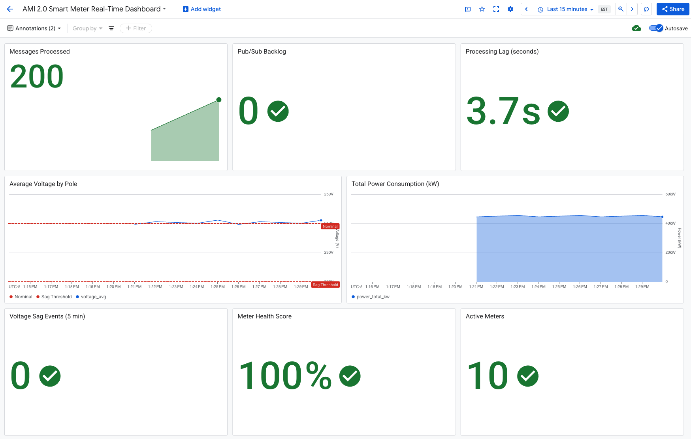
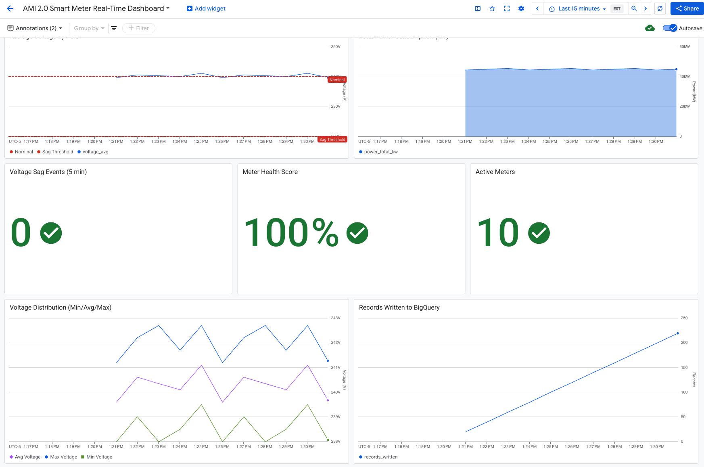

# Next-Gen Smart Meter Data Analytics on Google Cloud

[](https://github.com/IEEE-PES-TF-Cloud4PowerGrid/cloud_adoption_tutorials)
[](https://cloud.google.com/)
[](LICENSE)

This tutorial demonstrates a cloud-native architecture for ingesting, storing, and analyzing high-frequency data from **Advanced Metering Infrastructure (AMI)** smart meters using **Google Cloud Platform** services.

## 🎯 Overview

AMI 2.0 represents a significant evolution from legacy smart meters, enabling utilities to collect data at much higher frequencies for real-time grid monitoring and advanced analytics:

| Feature | Legacy Smart Meter | AMI 2.0 |
|---------|-----------|---------|
| Sampling Rate | 15-60 minutes | **30 seconds - 15 minutes** |
| Data per Meter/Day | ~24-96 readings | **96 - 2,880 readings** |
| Primary Use Cases | Billing, basic analysis | Real-time monitoring, DR, anomaly detection |
| Data Volume | Baseline | **6-30x more data** |
| Latency | Batch (daily/hourly) | Near real-time (minutes) |

This tutorial implements a realistic end-to-end pipeline with configurable sampling rates and a **real-time monitoring dashboard**, enabling:

- **Real-time grid monitoring** - Detect voltage anomalies within minutes via Cloud Monitoring dashboard
- **Demand Response (DR)** - Compute accurate baselines for DR programs
- **Non-intrusive load monitoring** - Analyze consumption patterns without additional sensors

## 🏗️ Architecture

```
┌─────────────────────────────────────────────────────────────────────────────┐
│                            Smart Meter Data Analytics                       │
└─────────────────────────────────────────────────────────────────────────────┘

  ┌──────────────────┐     ┌──────────────────┐     ┌──────────────────────┐
  │   Edge Layer     │     │  Cloud Ingestion │     │   Stream Processing  │
  │   (Power Poles)  │     │                  │     │                      │
  │                  │     │                  │     │                      │
  │  ┌────────────┐  │     │  ┌────────────┐  │     │  ┌────────────────┐  │
  │  │ AMI 2.0    │──┼──5G─┼──│  Pub/Sub   │──┼──┼──┼──│   Dataflow     │  │
  │  │ Meters     │  │  /  │  │  Topic     │  │     │  │   Pipeline     │  │
  │  │(30s-15min) │  │ Sat │  └────────────┘  │     │  └───────┬────────┘  │
  │  └────────────┘  │     │                  │     │          │           │
  │        │         │     │  ┌────────────┐  │     │          ▼           │
  │        ▼         │     │  │   Dead     │  │     │  ┌───────────────┐   │
  │  ┌────────────┐  │     │  │   Letter   │◄─┼─────┼──│ Parse/Validate│   │
  │  │ Gateway    │  │     │  │   Queue    │  │     │  │ Enrich        │   │
  │  │ Relay      │  │     │  └────────────┘  │     │  └───────────────┘   │
  │  └────────────┘  │     │                  │     │                      │
  └──────────────────┘     └──────────────────┘     └──────────────────────┘
                                                              │
                           ┌──────────────────────────────────┼──────────────┐
                           │                                  │              │
                           ▼                                  ▼              │
               ┌───────────────────┐              ┌───────────────────┐      │
               │   Cloud Storage   │              │    BigQuery       │      │
               │   (Raw Archive)   │              │    (Analytics)    │      │
               │                   │              │                   │      │
               │  gs://bucket/raw/ │              │ raw_meter_readings│      │
               │  ├── pole_A/      │              │  (partitioned)    │      │
               │  └── pole_B/      │              │                   │      │
               └───────────────────┘              └─────────┬─────────┘      │
                                                            │                │
                           ┌────────────────────────────────┤                │
                           │                                │                │
                           ▼                                ▼                │
               ┌───────────────────┐              ┌───────────────────┐      │
               │   Analytics       │              │   Cloud Run API   │      │
               │                   │              │                   │      │
               │  • Voltage Anomaly│              │  • /health        │      │
               │  • DR Baseline    │              │  • /pole/summary  │      │
               │  • Health Summary │              │  • /anomalies     │      │
               └───────────────────┘              │  • /dr/compute    │      │
                                                  └───────────────────┘      │
                                                                             │
                           └─────────────────────────────────────────────────┘
```

### Key Components

| Component | Service | Purpose |
|-----------|---------|---------|
| **Edge Simulation** | Python + VM | Generates realistic AMI 2.0 meter data (30s-15min intervals) |
| **Gateway Relay** | Python | Simulates network backhaul (5G/satellite/wired) |
| **Ingestion** | Pub/Sub | Decouples producers/consumers, handles bursts |
| **Processing** | Dataflow | Streaming ETL with validation |
| **Raw Archive** | Cloud Storage | Durable JSON/CSV data lake |
| **Analytics** | BigQuery | Partitioned tables for fast queries |
| **API** | Cloud Run | On-demand analytics endpoints |
| **Dashboard** | Cloud Monitoring | Real-time metrics visualization |

## 📋 Prerequisites

### Required Tools

- **Google Cloud SDK** (`gcloud`) - [Install Guide](https://cloud.google.com/sdk/docs/install)
- **Terraform** (≥ 1.0) - [Install Guide](https://developer.hashicorp.com/terraform/install)
- **Python** (≥ 3.9) - [Download](https://www.python.org/downloads/)

### GCP Project Setup

1. Create or select a GCP project
2. Enable billing
3. Enable required APIs:

```bash
gcloud services enable \
    pubsub.googleapis.com \
    dataflow.googleapis.com \
    bigquery.googleapis.com \
    storage.googleapis.com \
    compute.googleapis.com \
    run.googleapis.com
```

### Authentication

```bash
# Login to Google Cloud
gcloud auth login

# Set default project
gcloud config set project YOUR_PROJECT_ID

# Set up application default credentials
gcloud auth application-default login
```

### Verify Prerequisites

```bash
# Run the prerequisite check script
./scripts/00_prereq.sh
```

## 🚀 Quick Start

### Step 1: Deploy Infrastructure

```bash
cd smart_meter_analytics/infrastructure

# Initialize Terraform
terraform init

# Create terraform.tfvars
cat > terraform.tfvars << EOF
project_id = "YOUR_PROJECT_ID"
region     = "us-central1"
EOF

# Review and apply
terraform plan
terraform apply
```

This creates:
- Pub/Sub topic and subscription
- BigQuery dataset and tables
- Cloud Storage buckets
- Service accounts with appropriate IAM roles

### Step 2: Run Edge Simulator

In a new terminal:

```bash
cd smart_meter_analytics

# Install dependencies
pip install -r edge_simulation/requirements.txt

# Run simulator (dry-run mode first)
python edge_simulation/gateway_relay.py \
    --config edge_simulation/config.yaml \
    --project YOUR_PROJECT_ID \
    --dry-run \
    --duration 10

# Run with actual publishing
python edge_simulation/gateway_relay.py \
    --config edge_simulation/config.yaml \
    --project YOUR_PROJECT_ID
```

### Step 3: Launch Dataflow Pipeline

```bash
cd smart_meter_analytics

# Install dependencies
pip install -r cloud_processing/requirements.txt

# Launch streaming pipeline
./scripts/30_launch_dataflow.sh
```

Or manually:

```bash
python cloud_processing/streaming_pipeline.py \
    --runner DataflowRunner \
    --project YOUR_PROJECT_ID \
    --region us-central1 \
    --input_subscription projects/YOUR_PROJECT_ID/subscriptions/ami-meter-data-sub \
    --output_bq_table YOUR_PROJECT_ID:smart_grid_analytics.raw_meter_readings \
    --raw_archive_bucket YOUR_PROJECT_ID-ami-raw-archive \
    --temp_location gs://YOUR_PROJECT_ID-ami-dataflow-artifacts/temp \
    --staging_location gs://YOUR_PROJECT_ID-ami-dataflow-artifacts/staging \
    --worker_machine_type e2-standard-2 \
    --max_num_workers 2 \
    --streaming
```

### Step 4: Validate Data Flow

```bash
# Run validation queries
./scripts/40_run_queries.sh

# Or query directly
bq query --use_legacy_sql=false '
SELECT 
    pole_id,
    COUNT(*) as readings,
    AVG(voltage_v) as avg_voltage,
    SUM(power_kw) as total_power
FROM `YOUR_PROJECT_ID.smart_grid_analytics.raw_meter_readings`
WHERE event_ts >= TIMESTAMP_SUB(CURRENT_TIMESTAMP(), INTERVAL 1 HOUR)
GROUP BY pole_id
'
```

### Step 5: Run Analytics

```bash
# Detect voltage anomalies
./scripts/40_run_queries.sh anomalies

# Compute DR baseline
./scripts/40_run_queries.sh baseline

# Generate health summary
./scripts/40_run_queries.sh health
```

### Step 6: Deploy API (Optional)

```bash
cd smart_meter_analytics/services/api

# Build and deploy to Cloud Run
gcloud run deploy ami-analytics-api \
    --source . \
    --region us-central1 \
    --set-env-vars GOOGLE_CLOUD_PROJECT=YOUR_PROJECT_ID \
    --set-env-vars BQ_DATASET=smart_grid_analytics \
    --allow-unauthenticated
```

Test the API:

```bash
# Get pole summary
curl https://ami-analytics-api-XXX.run.app/pole/pole_A/summary

# Get recent anomalies
curl https://ami-analytics-api-XXX.run.app/anomalies
```

## 📁 Project Structure

```
smart_meter_analytics/
├── README.md                    # This file
├── architecture/
│   ├── diagram.mmd              # Mermaid architecture diagram
│   └── assumptions.md           # Data model and scaling assumptions
├── infrastructure/
│   ├── main.tf                  # Terraform resources
│   ├── variables.tf             # Input variables
│   ├── outputs.tf               # Output values
│   └── versions.tf              # Provider versions
├── edge_simulation/
│   ├── config.yaml              # Simulation configuration
│   ├── simulator.py             # Meter data generator
│   ├── gateway_relay.py         # Pub/Sub publisher
│   ├── requirements.txt         # Python dependencies
│   └── schemas/
│       └── telemetry.schema.json
├── cloud_processing/
│   ├── streaming_pipeline.py    # Dataflow pipeline
│   ├── transforms.py            # Beam transforms
│   ├── metrics_publisher.py     # Cloud Monitoring integration
│   ├── setup.py                 # Package setup
│   └── requirements.txt
├── analytics/
│   ├── README.md
│   ├── voltage_anomaly.sql      # Anomaly detection
│   ├── dr_baseline_5min.sql     # DR baseline
│   ├── feeder_health_summary.sql
│   └── bq_tables.sql            # DDL statements
├── services/
│   └── api/
│       ├── main.py              # FastAPI service
│       ├── requirements.txt
│       └── Dockerfile
└── scripts/
    ├── 00_prereq.sh             # Check prerequisites
    ├── 10_deploy_tf.sh          # Deploy infrastructure
    ├── 20_run_edge_vm.sh        # Run edge simulation
    ├── 30_launch_dataflow.sh    # Launch pipeline
    ├── 40_run_queries.sh        # Run analytics
    └── 90_cleanup.sh            # Delete all resources
```

## ⚙️ Configuration

### Edge Simulator (`edge_simulation/config.yaml`)

| Parameter | Default | Description |
|-----------|---------|-------------|
| `pole.num_meters` | 10 | Meters per pole |
| `sampling.sample_interval_seconds` | 30 | Interval between readings in seconds |
| `sampling.preset` | "high_frequency" | Preset: high_frequency (30s), standard (5min), low_frequency (15min) |
| `network.profile` | "5g" | Backhaul simulation (wired/5g/satellite) |
| `electrical.voltage.nominal_v` | 240 | Nominal voltage |
| `electrical.voltage.sag_threshold` | 220 | Voltage sag threshold |
| `demo.force_sag_every_n_intervals` | 10 | Force sag events every N intervals |

### Sampling Rate Presets

| Preset | Interval | Readings/Day/Meter | Use Case |
|--------|----------|-------------------|----------|
| `high_frequency` | 30 seconds | 2,880 | Real-time voltage monitoring |
| `standard` | 5 minutes | 288 | Typical utility deployment |
| `low_frequency` | 15 minutes | 96 | Bandwidth-constrained areas |

### Network Profiles

| Profile | Latency | Jitter | Drop Rate |
|---------|---------|--------|-----------|
| wired | 5-30ms | ±10ms | 0.01% |
| 5g | 20-200ms | ±50ms | 0.1% |
| lte_m | 50-300ms | ±100ms | 0.5% |
| satellite | 300-900ms | ±200ms | 1.0% |

## 📊 Real-Time Dashboard

This tutorial includes a **Google Cloud Monitoring dashboard** for real-time visualization of AMI data:

### Dashboard Features

- **Total Messages Ingested** - Pub/Sub throughput metrics
- **Pub/Sub Backlog** - Message queue depth with thresholds
- **Dataflow Processing Lag** - Pipeline latency monitoring
- **Average Voltage by Pole** - Real-time voltage with sag threshold lines
- **Total Power Consumption** - Aggregated power by pole
- **Voltage Sag Events** - Count of anomalies detected
- **Meter Health Score** - Overall grid health indicator (0-100%)
- **Active Meters** - Count of reporting meters

### Accessing the Dashboard

After deploying infrastructure with Terraform:

1. Navigate to [Cloud Monitoring](https://console.cloud.google.com/monitoring) in GCP Console
2. Go to **Dashboards** in the left menu
3. Find **"AMI 2.0 Smart Meter Real-Time Dashboard"**

### Enabling Metrics in Pipeline

To publish custom metrics to the dashboard, add the `--enable_monitoring_metrics` flag when launching the pipeline:

```bash
python cloud_processing/streaming_pipeline.py \
    --runner DataflowRunner \
    --project YOUR_PROJECT_ID \
    --enable_monitoring_metrics \
    --metrics_window_seconds 60 \
    # ... other options
```

### Dashboard example





## 💰 Cost Considerations

### Estimated Costs (Tutorial Scale)

| Service | Usage | Est. Cost/Hour |
|---------|-------|----------------|
| VM | 2c/8G | ~$0.07 |
| Pub/Sub | 2-20 msg/min | ~$0.01 |
| Dataflow | 2 workers | ~$0.20 |
| BigQuery | Storage + queries | ~$0.01 |
| Cloud Storage | 1 GB | ~$0.01 |
| Cloud Monitoring | Custom metrics | ~$0.01 |
| **Total** | | **~$0.31/hour** |

**Note:** The cost is a rough estimation of running the tutorial locally. Cost might be slightly higher if running the tutorial on GCP, which requires another VM instance.

### Cost Control Tips

1. **Limit runtime** - Use `--duration` flag in simulator
2. **Small workers** - Use `e2-small` or `e2-standard-2`
3. **Max workers** - Set `--max_num_workers 2`
4. **Partition expiration** - Auto-delete old data
5. **Clean up** - Run `./scripts/90_cleanup.sh` after demo

## 🧹 Cleanup

Remove all resources created by this tutorial:

```bash
./scripts/90_cleanup.sh
```

Or manually:

```bash
# Cancel Dataflow jobs
gcloud dataflow jobs cancel JOB_ID --region=us-central1

# Delete Cloud Run service
gcloud run services delete ami-analytics-api --region=us-central1

# Destroy Terraform resources
cd infrastructure
terraform destroy
```

## 🔬 Analytics Queries

### Voltage Anomaly Detection

Detects sustained voltage sags (< 220V for ≥ 5 seconds):

```sql
-- See analytics/voltage_anomaly.sql for full query
SELECT meter_id, event_start, duration_seconds, min_voltage_v, severity
FROM voltage_sag_events
WHERE duration_seconds >= 5
ORDER BY event_start DESC;
```

### DR Baseline Computation

Computes 5-minute average power baselines:

```sql
-- See analytics/dr_baseline_5min.sql for full query
SELECT pole_id, time_of_day, baseline_avg_kw
FROM dr_5min_baseline
ORDER BY pole_id, hour_of_day, minute_bucket;
```

## 📚 References

- [AMI 2.0 Buyers Guide](https://sense.com/wp-content/uploads/2024/05/AMI-2.0-Buyers-Guide.pdf)
- [Google Cloud Pub/Sub](https://cloud.google.com/pubsub/docs)
- [Apache Beam (Dataflow)](https://beam.apache.org/documentation/)
- [BigQuery Partitioned Tables](https://cloud.google.com/bigquery/docs/partitioned-tables)
- [Cloud Run](https://cloud.google.com/run/docs)

## 📄 License

This project is licensed under the Apache 2.0 License - see the [LICENSE](../LICENSE) file for details.

## 🤝 Contributing

Contributions are welcome! Please see the main repository's contributing guidelines.

The preparation of this tutorial is with help of multiple GenAI tools.

---

**IEEE PES Task Force on Cloud for Power Grid**  
*Building the future of cloud-native power grid applications*
